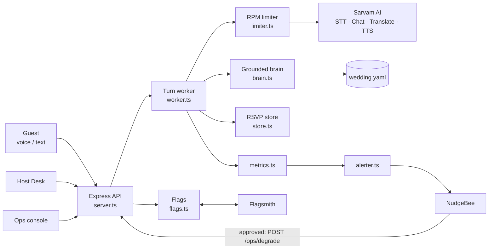

# AGENTS.md: HaanJi

> This file is the operating manual for anyone, human or AI agent, who changes this codebase. It explains what HaanJi is, why it's built this way, and the rules every change must keep. Read it before editing code.

---

## 1. What HaanJi is

**HaanJi is a multilingual voice concierge for Indian weddings.** The family shares one link. Guests ask questions by voice or text in **Hindi, Hinglish, English, Kannada or Tamil**, and HaanJi answers in the same language, **only from the wedding card**. RSVPs reach the caterer **only after the guest confirms**. When the wedding-morning rush overloads the AI provider, **NudgeBee** raises the alarm, **a human approves**, and **Flagsmith** degrades the experience gracefully, so every guest still gets an answer.

### Why it wins
| Problem at a real wedding | What HaanJi does |
| :--- | :--- |
| The family answers the same questions hundreds of times | One link answers schedule, venue, parking, dress code, food and RSVP questions around the clock |
| Elders can't use English-only apps | Voice in 5 Indian languages, plus Elder Mode (large text, AAA contrast, 0.85× speech) |
| AI assistants make things up | Card-only grounding with a post-check. Unknown questions go to the family, never invented |
| Caterer headcounts are wrong | Two-step "Haan, confirm" RSVP and deterministic arithmetic. The LLM never does the maths |
| 9:30 AM Muhurat rush breaks rate limits | Alert → NudgeBee investigation → human approval → Flagsmith level change → text replies |
| Demos fake their integrations | `/api/capabilities` probes every integration live and gives the reason when one is off |

### Product surfaces
- **Guest Concierge** (`/`): hold-to-ask voice, text, language chips, schedule, `.ics` calendar, two-step RSVP, Elder Mode, household links (`?h=IYER01`).
- **Host Desk** (`/host`): caterer totals per function, CSV export, household nudge list, **Answer-Once inbox** (answer an unknown question once and it's added to the card), translated announcements.
- **Ops Control Plane** (`/ops`): rate-limit charts, Muhurat Rush rehearsal, flag catalog, voice rollout slider, persona A/B readout, NudgeBee approvals, audit log.
- **Judge Mode** (`/judge`): read-only live counters.
- **Test Workbench**: runs every test suite in the browser.

---

## 2. Architecture



**Lifecycle of a guest turn:** `POST /api/turn` → validate (audio ≤ 2 MB, ≤ 30 s) → read flags (level, rollout, persona, `cfg_llm`) → STT `saarika:v2.5` → grounded chat `sarvam-m` over `data/wedding.yaml` → post-check against the card → translate `mayura:v1` → TTS `bulbul:v2` only if Level 0 and voice is allowed for this guest → client polls `GET /api/turn/:jobId`.

**Degradation levels** (`ops_degradation_level`): `0` live voice · `1` text replies, zero TTS · `2` queued async drain.

---

## 3. Non-negotiable rules

These rules are the product. A change that breaks one of them is a bug, however good it looks.

1. **Card-only answers.** Guest-facing answers come only from `data/wedding.yaml`, plus FAQs the host added through the inbox. Never let a model invent times, venues, prices, products or travel details. If the card doesn't cover it, return the localized safe phrase (`getSafePhrase` in `server/config.ts`) and log it to the host inbox.
2. **No RSVP without consent.** An RSVP counts towards the caterer tally only after `POST /api/rsvp/:gid/confirm`. Keep the two-step confirmation for any new action that sends guest data to someone else (vendors, print queues, travel partners).
3. **Deterministic maths.** Headcounts, totals and quotas are computed in code (`computeCatererSummary` in `server/store.ts`), never parsed from LLM output.
4. **Humans approve remediation.** Alerts may recommend, but only a human approval may change `ops_degradation_level` or the RPM budget. Every change is written to the audit log with actor and reason.
5. **Safe flag defaults.** Every flag has a default in `server/flags_config.ts`. If Flagsmith is unreachable, getters return safe defaults and the guest page keeps working. New guest-visible features default to **off**.
6. **Language parity.** Every guest-facing string, safe phrase and announcement must work in `hi`, `hinglish`, `en`, `kn` and `ta`. Don't ship a feature in English only.
7. **Accessibility.** Elder Mode (large text, AAA contrast, slower speech) must keep working on every new guest screen.
8. **Secrets stay server-side.** No API keys, `HAANJI_HOST_KEY` or `HAANJI_OPS_TOKEN` in client code, bundles or API responses. Ops UI actions go through the server-side proxy (`/api/ops-proxy/*`). Token comparisons use constant-time equality.
9. **Honest status.** Never show an integration as live when it isn't. Use `/api/capabilities` and label local simulations ("Local rehearsal", "Local Flag Store").
10. **Work with zero keys.** Offline card mode must answer in all 5 languages without any API key.

---

## 4. Commands

```bash
npm install          # install dependencies
npm run dev          # start the full-stack dev server on http://localhost:3000
npm run lint         # TypeScript type check (tsc --noEmit)
npm run build        # production build (Vite)
npm test             # unit, 30-case Golden Set, ops, causal loop, API security
```

**Before every commit:** `npm run lint && npm run build && npm test` must pass.

Useful URLs: `/?h=IYER01` (elder household) · `/?demo=1` (demo checklist) · `/api/capabilities?refresh=1` (live probes) · `/ops/metrics` (Prometheus).

---

## 5. Where to change what

| I want to… | Edit |
| :--- | :--- |
| Change wedding details, menu, FAQs | `data/wedding.yaml` (not `wedding.test.yaml`, which is the frozen Golden Set snapshot) |
| Change how questions are understood or answered | `server/brain.ts` |
| Change the voice pipeline or TTS gating | `server/worker.ts` |
| Change rate limiting | `server/limiter.ts` and `ops_sarvam_rpm_budget` |
| Change RSVP rules or caterer totals | `server/store.ts` |
| Add or change a feature flag | `server/flags_config.ts`, then `server/flags.ts` |
| Change alert thresholds or the NudgeBee payload | `server/alerter.ts` |
| Add an ops endpoint | `server/routes_ops.ts` (behind `X-Ops-Token`) |
| Change guest UI | `src/components/GuestConcierge.tsx`, `src/App.tsx` |
| Change host or ops UI | `src/components/HostDashboard.tsx`, `src/components/OpsControlPlane.tsx` |
| Add tests | `server/tests/golden_cases.ts` (answers) or `server/tests/runner.ts` (suites) |

### Adding a feature flag
1. Add the key, type, default and a one-line `controls` description to `FLAG_DEFAULTS` and `FLAG_CATALOG_META` in `server/flags_config.ts`.
2. Add a getter in `server/flags.ts` that returns the safe default when `unreachable` is true.
3. Read it in `syncFromFlagsmith()` with range validation.
4. It then appears in the Ops flag catalog. Add a test covering the default and the unreachable fallback.

### Adding a guest-facing answer type
1. Add the data to `data/wedding.yaml`.
2. Make sure `formatCardForPrompt` in `server/config.ts` includes it.
3. Add offline templates in all 5 languages in `server/brain.ts`.
4. Add Golden Set cases covering at least Hinglish, Kannada and Tamil.

---

## 6. Code conventions

- TypeScript throughout; `npm run lint` must be clean. Shared types go in `server/types.ts` (server) and `src/types/haanji.ts` (client).
- Keep the server modular: one responsibility per file in `server/`. No business logic in React components.
- New dependencies need a clear reason. Prefer what's already installed (Express, React 19, Tailwind v4, `motion`, `lucide-react`, `js-yaml`, `@google/genai`).
- Visual identity: the red-and-gold Indian wedding theme (marigold, jaali, silk, urli assets in `public/assets/landing/`). Don't introduce generic SaaS styling.
- Commit messages follow Conventional Commits: `feat(rsvp): …`, `fix(ops): …`, `docs: …`.

---

## 7. Roadmap modules: guardrails for building them

These are planned as **HaanJi for Business**. Build each one behind a flag that defaults to **off** and that the family controls from the Host Desk.

| Module | Flags | Guardrails |
| :--- | :--- | :--- |
| **Partner portal** (`/partner`) | `b2b_partner_portal`, `b2b_live_headcount`, `b2b_csv_export`, `b2b_vendor_broadcast`, `b2b_limits` | Each business is a Flagsmith identity with `business_type` and `plan` traits; plans are segments. Partners only see guest-confirmed data for weddings the family linked them to. |
| **Shop the look** | `shop_enabled`, `shop_featured_slot`, `exp_shop_placement` | Products appear next to dress codes, **never inside AI answers**. No in-app payments; buying hands off to the vendor's own store or WhatsApp. |
| **Travel** | `travel_enabled`, `travel_modes`, `travel_providers` (URL templates as remote config) | HaanJi never sells tickets; it hands off to redBus, IRCTC-authorised partners and flight search. Directions come only from the card. Arrival details need RSVP-style confirmation. |
| **Photo booth and print counter** | `photobooth_enabled`, `photo_frames`, `print_quota_per_guest`, `print_queue_paused` | Albums only reachable through the guest link. Host approves photographer uploads. Guests can delete their own photos. **No face recognition.** A print-queue backlog triggers a NudgeBee alert, and a human approves the pause. |

---

## 8. Definition of done

- [ ] `npm run lint`, `npm run build` and `npm test` pass
- [ ] All 10 rules in section 3 still hold
- [ ] Works in all 5 languages and in Elder Mode
- [ ] Works with Flagsmith unreachable and with zero API keys
- [ ] New flags are in `flags_config.ts` and visible in the Ops catalog
- [ ] README updated if setup, routes or features changed
