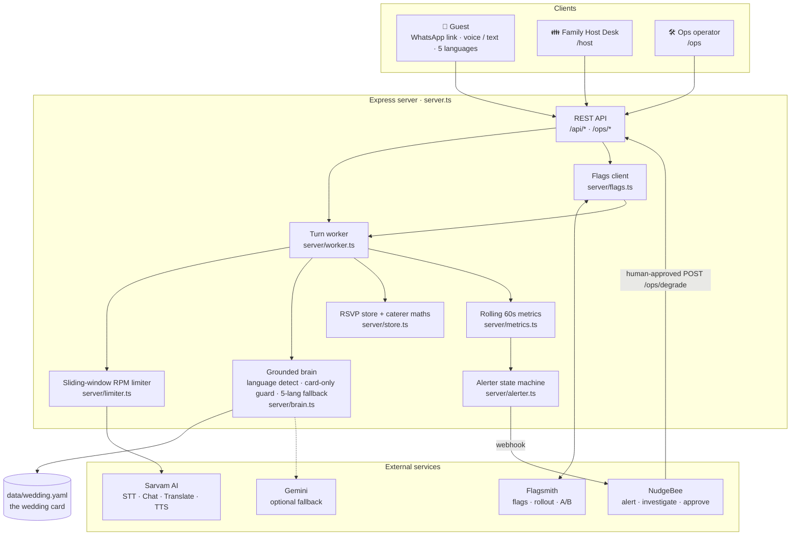
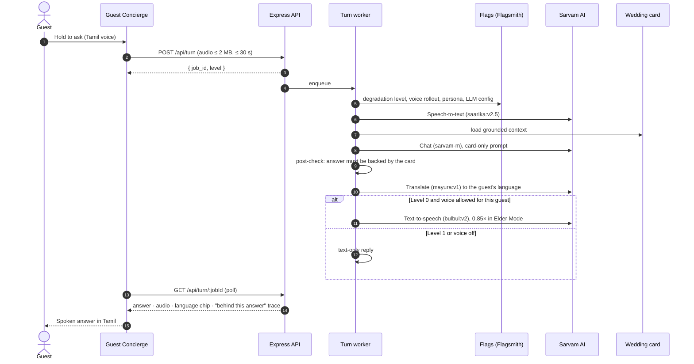
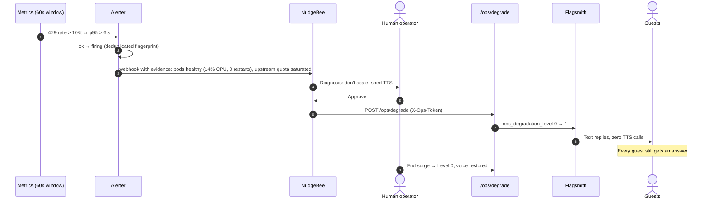
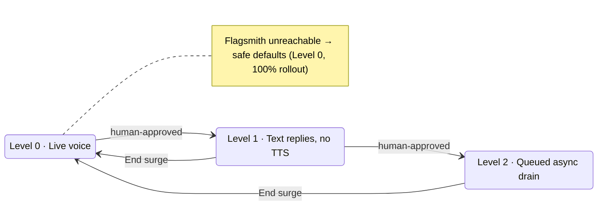

<div align="center">

# 🪷 HaanJi

### The multilingual voice concierge for Indian weddings

**Guests ask in their own language. HaanJi answers only from the wedding card.<br/>The family stops answering the same 200 phone calls.**

[](https://haanji-eight.vercel.app)
[](ADD_DEMO_VIDEO_URL_HERE)

[](https://www.typescriptlang.org/)
[](https://react.dev/)
[](https://expressjs.com/)
[](https://tailwindcss.com/)
[](https://www.sarvam.ai/)
[](https://www.flagsmith.com/)
[](https://nudgebee.com/)
[](LICENSE)

**Built by GenOS Team · WeMakeDevs Festive Hacks · Bengaluru**

</div>

---

## The problem

Between Diwali and New Year, an Indian family hosting a wedding becomes a call centre. *"What time is the Sangeet?" "Is there Jain food?" "Where do I park?" "Can you count us as four?"* The same questions, hundreds of times, often from elders who can't use English-only apps. The caterer's headcount ends up on a WhatsApp scribble, and it's wrong on the day.

## The solution

**HaanJi** (*"yes, ji"*: the respectful yes) is a guest concierge the family shares as one WhatsApp link.

- 🎙️ **Hold to ask, in your language.** Voice or text in **Hindi, Hinglish, English, Kannada and Tamil**. The reply is spoken back in the same language.
- 📜 **Answers only from the wedding card.** No hallucinated venues or times. If it isn't on the card, HaanJi says so and forwards the question to the family.
- ✅ **RSVPs only after "Haan, confirm".** A two-step confirmation goes to the caterer's tally. Nothing is counted until the guest says yes.
- 🧮 **Deterministic caterer totals.** Headcounts and Jain/veg splits are plain arithmetic over validated RSVPs. The LLM never does the maths.
- 👵 **Elder Mode.** Large text, AAA contrast and a 0.85× speaking pace, switched on automatically for elder households.
- 🛡️ **Stays up during the Muhurat rush.** When guest traffic spikes past the AI provider's rate limit, NudgeBee raises an alert, a human approves, and Flagsmith moves guests to text-only replies. Guests always get an answer.

<!-- Add screenshots to docs/screenshots/ with these file names -->
| Guest Concierge | Tamil voice answer | Ops Control Plane | NudgeBee approval |
| :---: | :---: | :---: | :---: |
|  |  |  |  |

---

## What's inside

| Surface | Route | Who it's for | What it does |
| :--- | :--- | :--- | :--- |
| **Guest Concierge** | `/` | Every guest | Voice and text Q&A in 5 languages, schedule, venue maps, `.ics` calendar download, two-step RSVP, Elder Mode |
| **Host Desk** | `/host` | The family | Live caterer totals per function, CSV export, nudge list of households yet to reply, **Answer-Once inbox** (answer an unknown question once and it's added to the card for everyone), multilingual announcements |
| **Ops Control Plane** | `/ops` | Whoever runs the event tech | Rate-limit charts, Muhurat Rush rehearsal, live Flagsmith flag catalog, voice rollout slider, persona A/B results, NudgeBee approval workflow, audit log |
| **Judge Mode** | `/judge` | Hackathon judges | Read-only live counters and caterer totals |
| **Test Workbench** | in-app | Engineers | Runs unit, 30-case Golden Set, ops, causal-loop and API-security suites from the browser |

---

## Architecture



### How a guest question flows



### The Muhurat Rush: alert → human approval → flag change

At 9:30 AM, the auspicious moment, hundreds of guests ask "where do I go?" at once. Sarvam allows 60 requests per minute. Adding servers would only produce more `429` errors, so HaanJi sheds load instead.



**Nothing changes automatically.** A human approves every remediation, and every change goes in the audit log.

### Graceful degradation levels



---

## How we use the sponsor tools

### Sarvam AI: the voice pipeline
| Stage | Model | Role |
| :--- | :--- | :--- |
| Speech-to-text | `saarika:v2.5` | Transcribes hold-to-ask audio and detects the Indian language |
| Chat | `sarvam-m` | Answers strictly from `data/wedding.yaml` and extracts structured RSVP patches (`headcount`, `functions`, `diet.jain`, `needs_room`) |
| Translate | `mayura:v1` | Makes sure answers and family announcements match the guest's language |
| Text-to-speech | `bulbul:v2` | Speaks the reply in the same language, slower in Elder Mode |

### Flagsmith: runtime control without redeploys
All flag keys and defaults live in [`server/flags_config.ts`](server/flags_config.ts).

| Flag | Default | Controls |
| :--- | :--- | :--- |
| `ops_degradation_level` | `0` | Degradation cascade: 0 live voice · 1 text only · 2 queued |
| `ops_sarvam_rpm_budget` | `40` | Sliding-window upstream budget, clamped to 5–55 RPM |
| `exp_voice_persona` | `formal` | 50/50 A/B test per guest: *formal* vs *warm* tone, measured on confirmed RSVPs |
| `rel_voice_reply` | all on | Per-language voice kill switch |
| `rel_voice_rollout_pct` | `100` | Percentage of guests who get live voice (stable hashing per guest ID) |
| `rel_elder_mode_default` | `false` | Elder Mode on by default for elder households |
| `cfg_llm` | `gemini-3.1-flash-lite`, `v2.1-grounded`, temp `0.2` | Model, prompt version, temperature and token cap as remote config |

If Flagsmith is unreachable, every getter falls back to a safe default and the guest page keeps working. You can rehearse this with the **"Flagsmith Unreachable"** switch on `/ops`.

The A/B readout is honest: below the sample size needed, it says **"inconclusive"** instead of declaring a winner.

### NudgeBee: incident response with a human in the loop
`server/alerter.ts` watches the rolling 60-second error rate. When the alert fires it posts to `NUDGEBEE_EVENT_WEBHOOK_URL` with evidence. NudgeBee's investigation shows the fix is shedding load, not scaling. A human approves, and the approved action calls `POST /ops/degrade`, which updates Flagsmith. Without a webhook configured, the Ops console labels the flow **"Local rehearsal"**, so it never pretends to be live.

---

## Engineering quality

- **Grounding guard:** every answer is checked against the card. Unknown questions get a polite "I've asked the family" in the guest's language and go to the Host Desk inbox.
- **Deterministic maths:** caterer totals come from validated RSVP records, never from model output.
- **Security:** Host routes use an HMAC-signed cookie or host key. Ops routes need `X-Ops-Token`, compared in constant time. Secrets are generated at startup if unset, and none are in the client bundle.
- **Input limits:** audio over 2 MB or 30 seconds gets `413`. The JSON body limit is 4 MB.
- **Observability:** Prometheus metrics at `/ops/metrics`, real capability probes at `/api/capabilities` (cached 60 s), and an audit log of every flag change.
- **Tests:** 5 suites: Track A unit, a **30-case multilingual Golden Set**, Track B ops, a causal-loop proof (alert → approval → flag → fewer 429s), and API security. All runnable from the CLI or the in-app workbench.
- **Works with zero keys:** offline card mode answers in all 5 languages using grounded templates.

---

## Getting started

### Prerequisites
- **Node.js 20+** and npm
- API keys are **optional**. Without them HaanJi runs in offline card mode.

### 1. Clone and install
```bash
git clone https://github.com/Nagaraj1399/HaanJi.git
cd HaanJi
npm install
```

### 2. Configure environment
```bash
cp .env.example .env
```

| Variable | Needed for | Where to get it |
| :--- | :--- | :--- |
| `SARVAM_API_KEY` | Live voice and AI | [Sarvam dashboard](https://dashboard.sarvam.ai) → API Keys |
| `GEMINI_API_KEY` | Optional AI fallback | [Google AI Studio](https://aistudio.google.com/apikey) (added automatically inside AI Studio) |
| `FLAGSMITH_ENV_KEY` | Live flags | Flagsmith → Environment → Settings → Environment key |
| `FLAGSMITH_SERVER_KEY` | Optional alias | Flagsmith server-side key |
| `FLAGSMITH_ADMIN_KEY` | Writing flag changes back | Flagsmith → Organisation → API Keys |
| `FLAGSMITH_ENV_ID` | Writing flag changes back | Flagsmith environment ID |
| `NUDGEBEE_EVENT_WEBHOOK_URL` | Live alerts | NudgeBee → Integrations → Event webhook |
| `NUDGEBEE_API_TOKEN` | NudgeBee status checks | NudgeBee → Settings → API Tokens |
| `HAANJI_HOST_KEY` | Host Desk access | Any long random string (random at startup if unset) |
| `HAANJI_OPS_TOKEN` | Ops access | Any long random string (random at startup if unset) |
| `APP_URL` | Deployed URL | Set by your host, or `http://localhost:3000` |

### 3. Run
```bash
npm run dev
```
Then open:
- `http://localhost:3000`: guest concierge
- `http://localhost:3000/?h=IYER01`: elder household preview (Elder Mode on)
- `http://localhost:3000/?demo=1`: guided demo checklist
- `http://localhost:3000/host` and `/ops`: Host Desk and Ops Control Plane

### 4. Verify
```bash
npm run lint      # TypeScript type check
npm run build     # production build
npm test          # unit, Golden Set, ops, causal loop, security
curl http://localhost:3000/api/capabilities   # which integrations are live, and why
```

### 5. Deploy to Vercel
1. Import the repository in Vercel.
2. Add the variables from `.env.example` under **Settings → Environment Variables**.
3. Deploy.

---

## Try the demo in 3 minutes

1. **Ask in five languages:** Hinglish ("Sangeet kab hai?"), Kannada and Tamil (Muhurat time), English (parking), then an RSVP. Each answer shows its language chip.
2. **Confirm an RSVP:** say "we are 4, two need Jain food" and tap **Haan, confirm**. Watch the caterer total update on `/host`.
3. **Ask something not on the card:** HaanJi says it has asked the family. Answer it once on the Host Desk and it's on the card for everyone.
4. **Run the Muhurat Rush:** on `/ops`, start the rehearsal, watch the 60 RPM breach and NudgeBee's diagnosis, click **Approve**. Guests switch to text replies. Click **End surge** to restore voice.

---

## API reference

| Method and path | Auth | Description |
| :--- | :--- | :--- |
| `GET /healthz` | Public | Service status and degradation level |
| `GET /api/capabilities` | Public | Live probe results for Sarvam, Gemini, Flagsmith and NudgeBee, with reasons |
| `GET /api/card` | Public | Wedding card, household profile, Elder Mode default, rollout status, RSVP, announcements |
| `POST /api/turn` | Public | Submit a voice or text question; returns `job_id` |
| `GET /api/turn/:jobId` | Public | Poll for the answer, audio, language and trace |
| `GET /api/rsvp/:gid` · `POST /api/rsvp/:gid` | Public | Read or edit an RSVP |
| `POST /api/rsvp/:gid/confirm` | Public | Guest confirms ("Haan"); counts towards the caterer tally |
| `GET /api/judge/state` | Public | Read-only counters for Judge Mode |
| `POST /api/host/unlock` | Host key | Starts a signed host session |
| `GET /api/host/state` | Host | Caterer totals, nudge list, inbox, experiment summary |
| `GET /api/host/csv/:fnId` | Host | CSV headcount export per function |
| `POST /api/host/add-to-card` | Host | Answer an inbox question and add it to the card |
| `POST /api/host/announcement` | Host | Translate and publish a family update |
| `GET /ops/metrics` | Public | Prometheus metrics |
| `GET /ops/state` | `X-Ops-Token` | Telemetry, flag catalog, workflows, audit log |
| `POST /ops/degrade` | `X-Ops-Token` | NudgeBee remediation target; updates the degradation level and RPM budget |
| `POST /api/tests/*` | Workbench | Runs the test suites |

---

## Project structure

```text
HaanJi/
├── server.ts                  # Express + Vite server (port 3000), auth, API routes
├── data/
│   ├── wedding.yaml           # The wedding card: single source of truth for answers
│   └── wedding.test.yaml      # Frozen snapshot for the Golden Set
├── server/
│   ├── brain.ts               # Language detection, grounded prompts, Sarvam/Gemini calls, post-check
│   ├── worker.ts              # Async turn pipeline, audio limits, TTS gating, answer trace
│   ├── limiter.ts             # Sliding-window RPM limiter with retry
│   ├── store.ts               # RSVP validation and deterministic caterer maths
│   ├── flags.ts               # Flag evaluation, rollout hashing, A/B tracking, Flagsmith sync
│   ├── flags_config.ts        # Every flag key, type, default and description
│   ├── metrics.ts             # Rolling 60s metrics + Prometheus export
│   ├── alerter.ts             # Alert state machine, NudgeBee webhook, approval workflow
│   ├── routes_ops.ts          # /ops routes and Muhurat Rush controller
│   ├── capabilities.ts        # Cached live probes of each integration
│   └── tests/                 # Golden Set (30 cases) and suite runner
└── src/
    ├── App.tsx                # Landing page, routing, household links
    └── components/
        ├── GuestConcierge.tsx
        ├── HostDashboard.tsx
        ├── OpsControlPlane.tsx
        ├── JudgeMode.tsx
        ├── TestWorkbench.tsx
        ├── WeddingCardDrawer.tsx
        └── DemoChecklist.tsx
```

---

## Roadmap: HaanJi for Business

These modules are designed and in progress. Each one sits behind a Flagsmith flag that is **off by default** and controlled by the family.

- [ ] **Partner portal (`/partner`):** caterers, decorators, photographers and travel operators sign in as businesses. Each business is a Flagsmith identity, and plan segments (Free / Pro) unlock features such as live headcount and CSV export without a redeploy.
- [ ] **Shop the look:** vendor outfits matched to each function's dress code, with buy, rent or WhatsApp-order buttons. Products never appear inside AI answers.
- [ ] **Travel:** a "Getting there" card from the wedding card, booking hand-offs to redBus, IRCTC-authorised train partners and flight search, arrival details in the RSVP, an arrivals sheet for the family, and local pickup vendors.
- [ ] **Photo booth and print counter:** themed frames per function, guest and photographer albums, and an on-site print queue with pickup codes. NudgeBee raises an alert when the print queue backs up.

## Known limitations

- **In-memory data:** RSVPs, the inbox and audit logs live in server memory and reset on restart. A database is the next step.
- **Single-replica rehearsal:** the Muhurat Rush simulates load against the in-process limiter rather than flooding Sarvam.
- **Audio fallback:** without a Sarvam key, playback falls back to browser speech synthesis or text.

---

## Team

**GenOS Team**: built for WeMakeDevs Festive Hacks, Bengaluru.

## License

[MIT](LICENSE)
